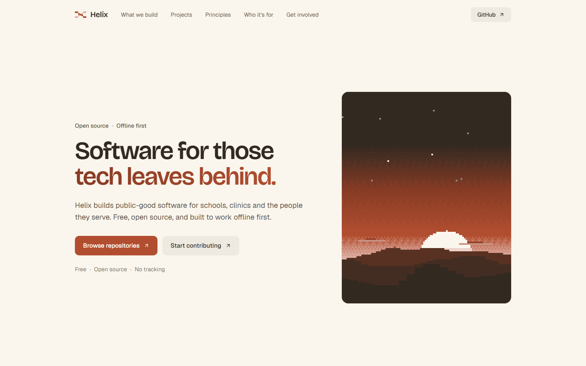
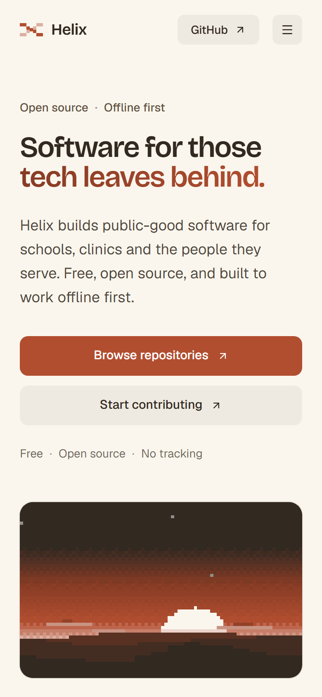
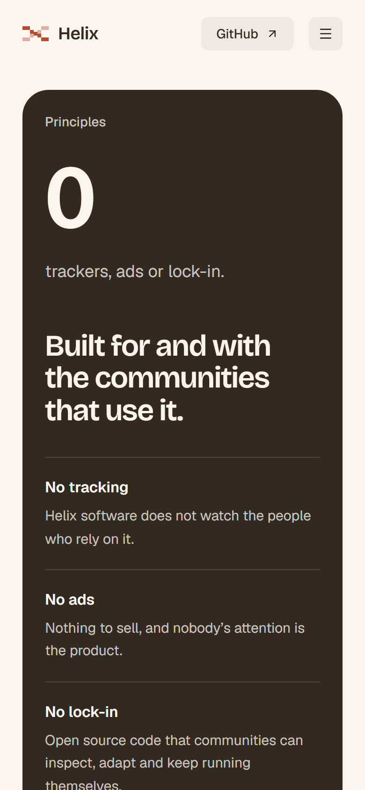
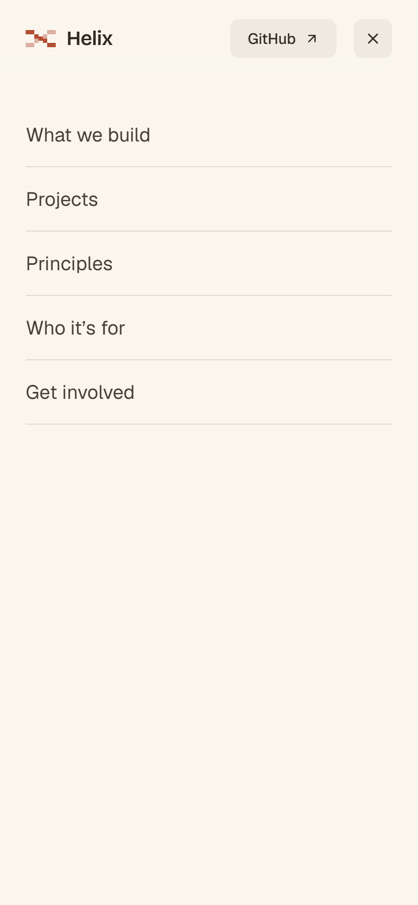
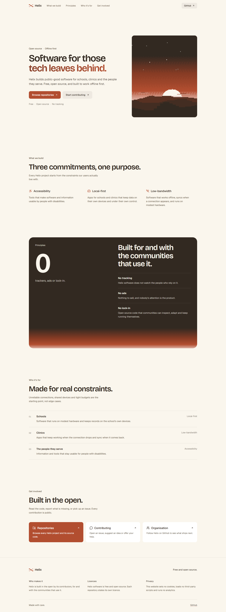

# helix-website

Website for [Helix](https://github.com/org-helix): public-good software, free, open source and offline first.

A static site built with [Astro](https://astro.build) and TypeScript. It ships HTML, CSS and two small scripts, with self-hosted fonts: no cookies, no analytics, no third-party requests.

**Live site: <https://org-helix.github.io/helix-website/>**



<p align="center">
  
  
  
</p>

<details>
<summary>Full page on desktop</summary>



</details>

## Commands

Requires Node 22.23.4 or newer (CI uses the version in `.nvmrc`).

| Command               | What it does                                                     |
| --------------------- | ---------------------------------------------------------------- |
| `npm install`         | Install dependencies                                             |
| `npm run dev`         | Start the dev server on <http://localhost:4321/helix-website/>   |
| `npm run build`       | Build the static site into `dist/`                               |
| `npm run preview`     | Serve the built site locally                                     |
| `npm run check`       | Type-check `.astro` and `.ts` files                              |
| `npm run lint`        | ESLint (TypeScript, Astro, accessibility rules)                  |
| `npm run format`      | Format with Prettier                                             |
| `npm test`            | Unit tests (Vitest)                                              |
| `npm run test:e2e`    | Browser and accessibility tests (Playwright + axe), on the build |
| `npm run verify`      | Everything CI runs, in order                                     |
| `npm run screenshots` | Retake the README screenshots from the build                     |

Before the first `npm run test:e2e` or `npm run screenshots`, install the browser once: `npx playwright install chromium`.

## Deployment

Every push to `main` runs the checks in `.github/workflows/ci.yml`. When they all pass, the same build is published to GitHub Pages. Pull requests run the checks but never deploy.

The site is served under `/helix-website/`, set as `base` in `astro.config.mjs`. Internal links must go through `withBase()` from `src/lib/url.ts`; an end-to-end test fails if a link or asset escapes the base path. To move to a custom domain, set `site` to the domain and `base` to `'/'`.

## Where things live

```
src/
  content/site.ts      All copy and links. Edit text here, not in components.
  styles/
    dusk/tokens.css    Dusk DS tokens, copied verbatim. Never edit here.
    theme.css          Helix palette and semantic colour tokens. The only place colours are defined.
    global.css         Reset and shared .ds-* classes.
  components/          One file per section, plus Button, Icon, Logo, SectionIntro.
  scripts/             Header behaviour and the pixel-art illustration.
  lib/color.ts         Colour parsing and WCAG contrast helpers.
  pages/               index and 404.
tests/
  unit/                Palette, contrast, content rules, colour helpers.
  e2e/                 Rendering, navigation, privacy promise, accessibility.
scripts/screenshots.mjs  Takes the README screenshots (desktop 1440 × 900, phone 390 × 844).
docs/screenshots/      The images shown above. Retake them after a visual change.
```

## Design

Layout, type scale, spacing, radii and motion follow the Dusk design system. Colours are the Helix palette on a light canvas, which is a deliberate departure from Dusk's dark violet theme.

| Name         | Hex                                           | Used for                                      |
| ------------ | --------------------------------------------- | --------------------------------------------- |
| Red          | `#B24E30`                                     | Primary action, links, accent                 |
| Pale Amber   | `#FAF6ED`                                     | Page background                               |
| Paper White  | `#FFFFFF`                                     | Cards, text on red                            |
| Dusty Orange | `#635242`                                     | Secondary text                                |
| Stone Gray   | `#918F89`                                     | Decorative separators only (fails AA as text) |
| Pale Orange  | `#ECD3CB`                                     | Card hover, selection                         |
| Gradient     | `#322921` → `#863B24` → `#B24E30` → `#DCAFA2` | Illustration, inverse panel, headings         |

Two rules are enforced by tests:

- Components never contain a raw colour; they use tokens from `theme.css`.
- Every text and background pair in the theme meets WCAG AA contrast. Change a colour and `npm test` tells you if it still passes.
